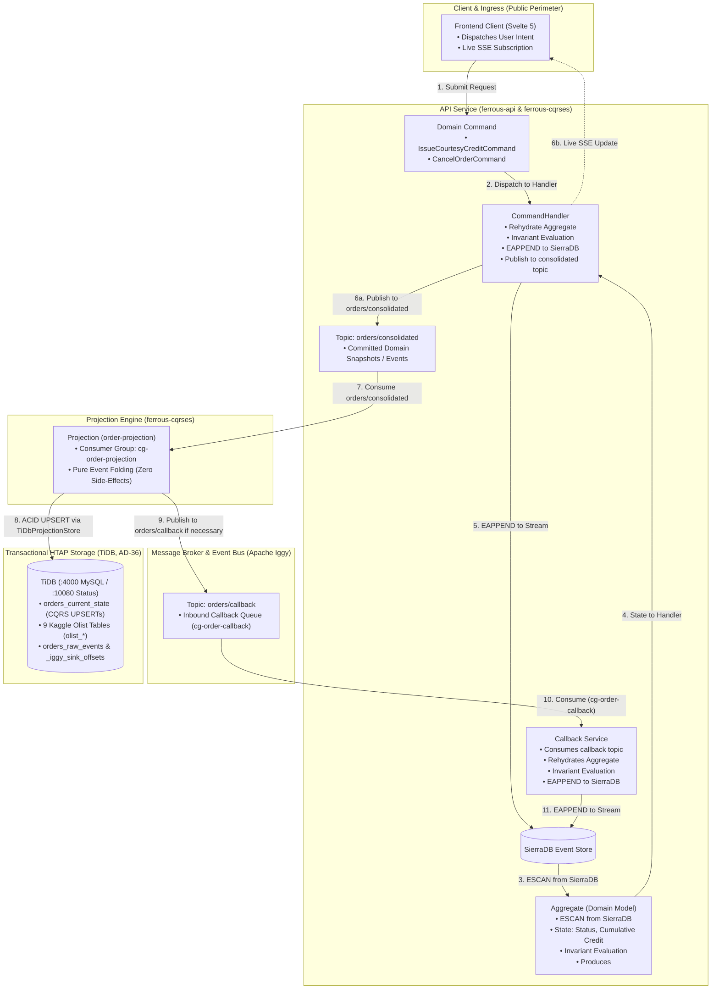
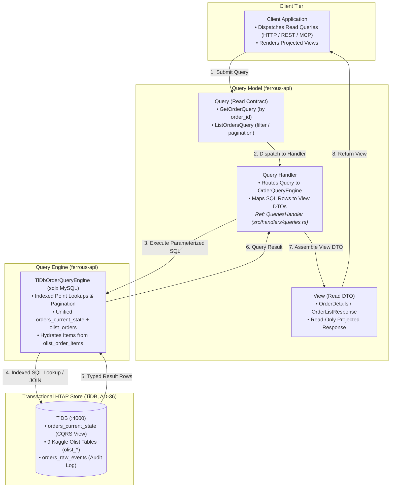
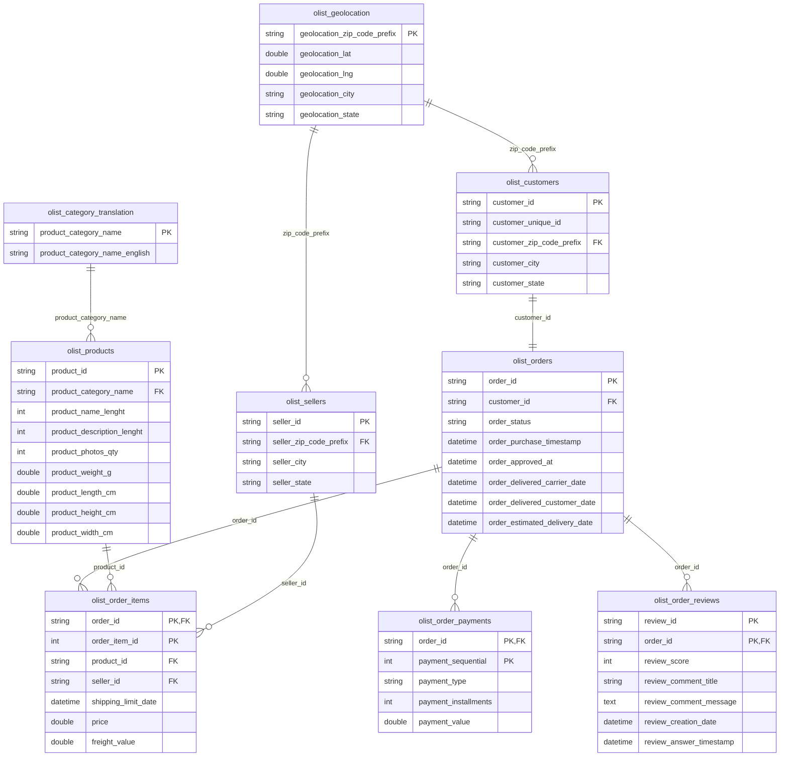

# FerrousCX

### Enterprise Conversational AI & Customer Experience Platform

[](https://github.com/reidlai/ferrous-cx)
[](https://github.com/reidlai/ferrous-cx)
[](#2-component-repositories-eight-autonomous-submodules)
[](https://docs.docker.com/compose/)
[](https://opentelemetry.io/)
[](LICENSE)

**FerrousCX** is an enterprise-grade, event-driven conversational AI and customer experience platform built on a high-performance **Rust-native stack**, integrating modern web copilot interfaces with an ultra-low-latency lakehouse architecture.

---

## 🚀 Release 1 MVP: Svelte Copilot & Rust Agentic Core

**Release 1** focuses on delivering an end-to-end, high-performance web copilot experience grounded on real-world e-commerce data:

1. **Frontend:** **Svelte 5** + **shadcn-svelte** in a 3-column layout featuring a **Transparent Agentic Workbench** and **Human-in-the-Loop (HITL)** approval workflows.
2. **Reactive Bridge:** **RxJS** unidirectional data stream bridging SSE events to Svelte 5 Runes.
3. **UI Architecture:** Strict **Atomic Design** hierarchy ensuring clean separation of presentation and business logic.
4. **Backend API Service Layer:** **Rust / Axum** API Service driven by **Goa Design v3** contracts and `rust-axum` OpenAPI code generation, leveraging native **Axum SSE** for real-time browser synchronization and **`TiDbOrderQueryEngine`** (`sqlx` MySQL + `tls-rustls`) for indexed transactional SQL queries.
5. **Transactional HTAP Persistence:** **TiDB** (`pingcap/tidb`, single-node `unistore` locally, distributed TiDB in Kubernetes) storing all **9 Kaggle Olist tables**, CQRS `orders_current_state`, `orders_raw_events`, and `hpc_benchmarks` with ACID `INSERT ... ON DUPLICATE KEY UPDATE` UPSERTs (**AD-36**).
6. **Traffic Simulation:** **`stream-replay-rs`** (Git submodule at project root), replaying historical CSV/Parquet/JSONL datasets into **Apache Iggy** via its native batched HTTP sink (`http://127.0.0.1:3000`, `olist/*_stream`, `orders/intake`, `benchmark/hpc_mqbench`) with real-time timestamp shifting.
7. **Flagship Scenario:** Brazilian E-Commerce dataset (**Olist**) for order tracking, shipment delay resolution, review analysis, and courtesy credits.

---

## 🏛️ System Architecture Topology

FerrousCX follows strict **Domain-Driven Design (DDD)** and **Command Query Responsibility Segregation (CQRS)** with **Event Sourcing (ES)**.

To clearly understand the operational boundaries and how domain components collaborate, the architecture separates the **Write Model (Commands, Handlers, Aggregates, Event Store & Domain Projections)** from the **Read Model (Projections, Lakehouse & Query Engines)**.

---

### 1. CQRS / ES Component Collaboration (Write Path)

The Write Path demonstrates how **Command**, **Command Handler**, **Aggregate**, **Event Store (SierraDB)**, and **Projections (Iggy & `TiDbProjectionStore`)** collaborate to enforce business invariants, update transactional read-model persistence in **TiDB**, and stream real-time updates:



#### How Command, Command Handler, Aggregate, Callback Service, and Projection Work Together:

| Component            | Concrete Implementation                                                | Role in Lifecycle & Invariants                                                                                                                                                                                                                                                                                                                       |
| :------------------- | :--------------------------------------------------------------------- | :--------------------------------------------------------------------------------------------------------------------------------------------------------------------------------------------------------------------------------------------------------------------------------------------------------------------------------------------------- |
| **Command**          | `IssueCourtesyCreditCommand`<br/>`CancelOrderCommand`                  | **Intent:** Immutable data contract encapsulating a user request to modify state. Does not mutate state directly.                                                                                                                                                                                                                                    |
| **CommandHandler**   | `CommandHandler`<br/>(`ferrous-cqrses/src/domain/order/handler.rs`)    | **Orchestrator:** Interacts with `SierraDB` to rehydrate the `Aggregate` (`ESCAN`), delegates command execution to the aggregate, enforces aggregate versioning, atomically persists resulting events via `EAPPEND`, and broadcasts committed state to `orders/consolidated`.                                                                        |
| **Callback Service** | `Callback Service`<br/>(`ferrous-cqrses/src/domain/order/callback.rs`) | **Callback Stream Consumer:** Consumes inbound callback messages from Apache Iggy (`orders/callback`, `cg-order-callback`), executes the same `CommandHandler` pipeline (`ESCAN` rehydrate → invariant evaluation → `EAPPEND` to SierraDB), and notifies live SSE listeners.                                                                         |
| **Aggregate**        | `Aggregate`<br/>(`ferrous-cqrses/src/domain/order/aggregate.rs`)       | **Guardian of Invariants:** Domain entity maintaining internal state purely from past events. Evaluates business rules: e.g. **maximum $20 cumulative courtesy credit**, order lifecycle state compatibility (`Delivered`/`InTransit`), and emits uncommitted **Domain Events** (`CourtesyCreditIssued`, `OrderCancelled`, `CourtesyCreditSettled`). |
| **Event Store**      | `SierraDB` (Port 9090)<br/>(`sierra.rs`)                               | **Single Source of Truth:** Pure-Rust RESP3 append-only log. Ensures linear, atomic event ordering without table locks.                                                                                                                                                                                                                              |
| **Iggy Topics**      | `orders/callback`, `orders/consolidated`, `olist/*_stream`             | **`orders/callback`:** Inbound callback queue consumed by `Callback Service`. **`orders/consolidated`:** Committed snapshots/events for TiDB (`orders_current_state`) and `order-saga`. **`olist/*_stream`:** Transactional Olist streams consumed by `tidb-sink`.                                                                                         |
| **Projection**       | `order-projection`<br/>(`ferrous-cqrses/src/bin/order_projection.rs`)  | **Read Model Materializer:** Consumes `orders/consolidated` under consumer group `cg-order-projection`, folds events into canonical `AD-34` snapshots, and persists `orders_current_state` directly to **TiDB via `TiDbProjectionStore` (`sqlx` MySQL)**.                                                                                                  |

---

### 2. CQRS / ES Query Model (Read Flow)

Following strict **CQRS / ES**, the **Query Model** is dedicated purely to read-only **Queries** and **Materialized Views** powered by **`TiDbOrderQueryEngine`** (`sqlx` MySQL + `tls-rustls`) against **TiDB** (`orders_current_state` + all 9 `olist_*` tables, **AD-36**), completely decoupled from write-side aggregates, event stores, and downstream analytics/AI workloads:

> **Roadmap Note:** Analytics (OLAP/BI) and the Agentic Path (`ferrous-agent`, `rig-core`, `Qdrant Vector DB`) are cleanly separated behind the `OrderQueryEngine` trait and `/mcp` Streamable HTTP boundary (`AD-30`, `AD-33`).



#### How Query, Query Handler, `TiDbOrderQueryEngine`, and TiDB Work Together:

| Component             | Concrete Implementation                                               | Role in CQRS / ES Query Model                                                                                                                                                                     |
| :-------------------- | :-------------------------------------------------------------------- | :------------------------------------------------------------------------------------------------------------------------------------------------------------------------------------------------ |
| **Query**             | `GetOrderQuery`<br/>`ListOrdersQuery`                                 | **Read Contract:** Side-effect-free request describing what state to retrieve without mutating any domain aggregate.                                                                              |
| **Query Handler**     | `QueriesHandler`<br/>(`ferrous-api/src/handlers/queries.rs`)          | **Read Coordinator:** Translates incoming REST / MCP queries into canonical `ferrous-cqrses` Query structs, invokes `OrderQueryEngine`, and renders typed View DTOs.                              |
| **Query Engine**      | **`TiDbOrderQueryEngine`**<br/>(`ferrous-api/src/tidb_query_engine.rs`) | **Transactional SQL Engine:** Implements `OrderQueryEngine` over `sqlx` (`mysql` + `tls-rustls`) with indexed lookups, pagination, and `olist_order_items` hydration (`InMemoryOrderQueryEngine` for unit tests). |
| **Materialized View** | **TiDB** (`orders_current_state`, 9 `olist_*` tables)                 | **Transactional Read Store:** ACID-updated by `order-projection` (`TiDbProjectionStore`) and `tidb-sink`, supporting primary-key point lookups and multi-table SQL JOINs without replaying SierraDB. |
| **View (DTO)**        | `OrderDetails`<br/>`OrderListResponse`                                | **Projected Output:** Immutable, client-facing representation shaped specifically for UI/API/MCP consumption.                                                                                     |

---

## 🎨 Frontend Architecture (Svelte 5 + Atomic Design)

The frontend adopts a responsive 3-column layout designed specifically for enterprise agentic workflows:

```text
┌──────────────┬──────────────────────────────────────────┬─────────────────────────────┐
│  Left Menu   │          Middle Content Panel            │       Right AI Sidecar      │
│  (Sidebar)   │           (Operational Canvas)           │   (Transparent Workbench)   │
├──────────────┼──────────────────────────────────────────┼─────────────────────────────┤
│ • Dashboard  │  Order #7a12b - Delayed in Transit       │  ▶ Thought Process (1.4s)   │
│ • Orders     │  ┌────────────────────────────────────┐  │                             │
│ • Customers  │  │ Status: [ In Transit - Alert ]     │  │  ⚡ Tool: query_lakehouse   │
│ • Settings   │  │ Est. Delivery: Oct 28 (2 days late)│  │     Latency: 2.4ms (DataFusion)
│   (API Keys) │  └────────────────────────────────────┘  │                             │
│              │  Items & Timeline:                       │  "The carrier reported a    │
│              │  • Wireless Earbuds ($49.99)             │   delay. Courtesy credit?"  │
│              │  Customer Sentiment: 😠 Frustrated       │                             │
│              │                                          │  ┌───────────────────────┐  │
│              │  [Contact Carrier]                       │  │ [Approve $15 Credit]  │  │
│              │                                          │  └───────────────────────┘  │
└──────────────┴──────────────────────────────────────────┴─────────────────────────────┘
```

### 1. RxJS Unidirectional Reactive Bridge

To guarantee predictable state management and handle high-throughput streaming events, an **RxJS observable pipeline** acts as the bridge between Axum's SSE stream and SvelteKit Runes:

$$\text{Axum SSE Stream} \xrightarrow{\text{EventSource / Fetch}} \textbf{RxJS Observable Pipeline} \xrightarrow{\text{Operators (map/filter/buffer)}} \textbf{Svelte 5 Runes } (\$state)$$

- **Unidirectional Flow:** SSE events enter RxJS observables, pass through pipeline operators (buffering tokens, handling backpressure, and routing tool-execution payloads), and update Svelte 5 `$state` runes.
- **Component Reactivity:** UI components purely read from `$state` and `$derived` runes; they never mutate streaming state directly.

### 2. Atomic Design Hierarchy

- **Atoms (Pre-built shadcn-svelte):** Primitive building blocks (`Button`, `Card`, `Badge`, `Accordion`, `Input`, `Separator`, `ScrollArea`).
- **Molecules (Pure Visual Presentation):** Stateless composite components maintaining zero business logic:
  - `ChatMessageBubble`: Displays message text and formatting.
  - `LatencyPill`: Formats query execution time (`2.4ms`) and engine badges.
  - `ToolCallHeader`: Renders tool name, status spinner, and arguments summary.
  - `ApprovalCardFrame`: Visual frame and action buttons for HITL prompts.
- **Organisms (Business Logic & State):** Domain-aware components connected to RxJS streams and Svelte runes:
  - `CopilotSidecarWorkbench`: Orchestrates message dispatch, thought accordions, and active tool calls.
  - `OrderResolutionCanvas`: Subscribes to order selection state, rendering live Olist items, timelines, and customer metrics.
  - `HitlApprovalWidget`: Handles approval/rejection button clicks and dispatches state-change mutations to the API gateway (`ferrous-api`).
  - `ProviderSettingsModal`: Manages user-supplied API keys (OpenAI, Anthropic, Google AI Studio, OpenRouter) stored locally in the browser.

---

## ⚡ High-Performance Rust Stack

- **API Service (`ferrous-api`):** **Rust / Axum** driven by **Goa Design v3** declarative contracts, compiling OpenAPI v3 specs into strongly typed Rust server traits via `rust-axum` and synchronizing live browser state via native **Axum SSE** (`axum::response::sse::Sse`).
- **LLM Orchestration:** **`rig` (`rig-core`)** for pure-Rust agent pipelines, prompt construction, native tool execution, and direct Hugging Face integration via `rig::providers::huggingface` (`huggingface::QWEN2_5`).
- **Transactional HTAP Persistence (`TiDB`, AD-36):** **TiDB** (`pingcap/tidb`, MySQL wire protocol `:4000`, HTTP status `:10080`, single-node `--store=unistore` locally) stores all **9 Kaggle Olist tables**, `orders_current_state`, `orders_raw_events`, `hpc_benchmarks`, and `_iggy_sink_offsets` with primary keys, secondary indexes, and ACID `INSERT ... ON DUPLICATE KEY UPDATE` semantics. Queried by `ferrous-api` via `TiDbOrderQueryEngine` (`sqlx` pure-Rust `mysql` + `tls-rustls`).
- **Transactional Event Store:** **SierraDB** (`sierradb`), pure-Rust RESP3 distributed event store providing sub-millisecond atomic append operations (`EAPPEND`), event stream scanning (`ESCAN`), and version checks (`ESVER`) with optimistic concurrency control for `ferrous-cqrses` aggregates.
- **Message Broker & Custom TiDB Sink (`tidb-sink`, AD-24, AD-36):** **Apache Iggy** for ultra-high throughput event and telemetry streaming paired with our custom pure-Rust **`tidb-sink`** daemon (`12 MB` `FROM scratch`, UID `10001`), transforming JSON payloads from `olist/*_stream`, `orders/consolidated`, `orders/intake`, and `benchmark/hpc_mqbench` into batched transactional TiDB UPSERTs with atomic offset checkpointing.
- **CQRS-ES Engine (`ferrous-cqrses`):** Pure-Rust Domain-Driven CQRS/ES engine built on the `cqrs-es` crate. Under Topology A, `ferrous-api` hosts the synchronous `CommandHandler` backed by SierraDB (`EventStore`) enforcing invariants ($20 courtesy credit cap, lifecycle states) before committing atomic event streams (`EAPPEND`), and dispatches committed domain state to Apache Iggy (`orders/consolidated`). The `Projection` (`order-projection`, `cg-order-projection`) consumes `orders/consolidated`, commits materialized snapshots directly to TiDB `orders_current_state` via `TiDbProjectionStore`, and publishes callbacks to `orders/callback`, where `Callback Service` (`cg-order-callback`) runs the same `ESCAN` → Rehydrate Aggregate → Invariant Evaluation → `EAPPEND` pipeline against SierraDB.

### Direct `rig` + `DataFusion` Integration

Tools implement `rig::tool::Tool` and directly hold an `Arc<SessionContext>`:

```rust
pub struct LakehouseOrderQueryTool {
    pub df_ctx: Arc<SessionContext>,
}

impl Tool for LakehouseOrderQueryTool {
    const NAME: &'static str = "query_order_lakehouse";
    type Error = ToolError;
    type Args = OrderQueryArgs;
    type Output = OrderSummary;

    async fn call(&self, args: Self::Args) -> Result<Self::Output, Self::Error> {
        let sql = format!("SELECT * FROM orders WHERE order_id = '{}'", args.order_id);
        let df = self.df_ctx.sql(&sql).await?;
        let batches = df.collect().await?;
        // Scanned in-memory in ~2ms with zero IPC overhead
        Ok(parse_order_summary(batches)?)
    }
}
```

---

## 🔄 Real-Time Traffic Simulation (`stream-replay-rs`)

`stream-replay-rs` ([reidlai/stream-replay-rs](https://github.com/reidlai/stream-replay-rs)) is the **generic, independent** replayer used by this repository to turn the Olist dataset into live traffic. It knows nothing about FerrousCX: the dataset, the replay profiles and the topics (`orders/intake`, `benchmark/hpc_mqbench`) belong to `ferrous-cx`. It is never controlled from the UI, the API or the agent.

### Key Capabilities

- **Dual Format:** Usable as a standalone CLI tool (`cargo install`) and as an embeddable library crate dependency in other Rust services.
- **Dataset Agnostic:** Ingests CSV, Parquet or JSONL files (`--input-file-format parquet --input-file-path <path>`) across arbitrary domains.
- **Pluggable Multi-Sink Architecture:** Dispatches events natively to Apache Iggy (`--sink iggy`, batched per-partition HTTP workers at 135k–155k+ msg/s), Kafka (`--sink kafka`), NATS JetStream (`--sink nats`), Fluvio (`--sink fluvio`), Eclipse iceoryx2 zero-copy IPC (`--sink iceoryx2`), or terminal inspection (`--sink stdout`).
- **Timestamp Rebasing and Speed:** Rebases historical event timestamps onto the live clock and paces them by `--speed` (default `1.0`, original spacing) or by a fixed `--rate` in events per second. The two are mutually exclusive.

---

## 📊 Flagship Scenario & Playback Calibration

### 1. Olist Brazilian E-Commerce Dataset (Flagship for Release 1)

- **Purpose:** Retail customer support, order fulfillment, shipping delay mitigation, and sentiment analysis.
- **Schema:** Full **9-table** relational SQL schema in TiDB ([`config/tidb/schema.sql`](config/tidb/schema.sql)) matching the downloadable Kaggle [`olistbr/brazilian-ecommerce`](https://www.kaggle.com/datasets/olistbr/brazilian-ecommerce) dataset: `olist_orders`, `olist_order_items`, `olist_order_payments`, `olist_order_reviews`, `olist_customers`, `olist_products`, `olist_sellers`, `olist_geolocation` (CEP-deduplicated), and `olist_category_translation`.
- **Execution:** Transactional fact tables stream live through `stream-replay-rs` into **Apache Iggy** $\rightarrow$ custom pure-Rust **`tidb-sink`** $\rightarrow$ **TiDB**; static reference dimensions batch-UPSERT via `streaming-admin load-olist-tidb`. Queried in real time by `ferrous-api` (`TiDbOrderQueryEngine`) and `rig` agents over `/mcp`.

#### Complete 9-Table Olist Entity-Relationship Diagram (TiDB Schema, AD-34 / AD-35 / AD-36)



#### 9-Table Olist Schema & FerrousCX Ingestion Map

| # | Kaggle CSV File | TiDB Table | Primary / Join Keys | Ingestion Path |
| :-: | :--- | :--- | :--- | :--- |
| 1 | `olist_orders_dataset.csv` | `olist_orders` *(AD-34 base)* | PK: `order_id`, FK: `customer_id` | Streamed: `profiles/olist-demo.toml` → `olist/orders_stream` → `tidb-sink` |
| 2 | `olist_order_items_dataset.csv` | `olist_order_items` | PK: `(order_id, order_item_id)`, FK: `product_id`, `seller_id` | Streamed: `profiles/olist-items.toml` → `olist/order_items_stream` → `tidb-sink` |
| 3 | `olist_order_payments_dataset.csv` | `olist_order_payments` | PK: `(order_id, payment_sequential)` | Streamed: `profiles/olist-payments.toml` → `olist/order_payments_stream` → `tidb-sink` |
| 4 | `olist_order_reviews_dataset.csv` | `olist_order_reviews` | PK: `(review_id, order_id)` | Streamed: `profiles/olist-reviews.toml` → `olist/order_reviews_stream` → `tidb-sink` |
| 5 | `olist_customers_dataset.csv` | `olist_customers` | PK: `customer_id`, IDX: `customer_unique_id` | Batch UPSERT: `streaming-admin load-olist-tidb` |
| 6 | `olist_products_dataset.csv` | `olist_products` | PK: `product_id`, FK: `product_category_name` | Batch UPSERT: `streaming-admin load-olist-tidb` |
| 7 | `olist_sellers_dataset.csv` | `olist_sellers` | PK: `seller_id`, IDX: `seller_zip_code_prefix` | Batch UPSERT: `streaming-admin load-olist-tidb` |
| 8 | `olist_geolocation_dataset.csv` | `olist_geolocation` | PK: `geolocation_zip_code_prefix` *(deduplicated)* | Batch UPSERT: `streaming-admin load-olist-tidb` (averaged lat/lng per CEP) |
| 9 | `product_category_name_translation.csv` | `olist_category_translation` | PK: `product_category_name` | Batch UPSERT: `streaming-admin load-olist-tidb` |

> [!TIP]
> **Kaggle Olist Data Modeling Notes:**
> - **`customer_id` vs `customer_unique_id`:** `olist_orders.customer_id` is generated *per order* (1:1 with `olist_customers.customer_id`). Repeat-buyer queries must group by `customer_unique_id`.
> - **Exact Kaggle CSV Spelling:** `olist_products_dataset.csv` spells `product_name_lenght` and `product_description_lenght` with **`lenght`** — preserved verbatim in TiDB DDL for zero-translation loading.
> - **Geolocation Deduplication:** Raw `olist_geolocation_dataset.csv` has many lat/lng rows per 5-digit CEP prefix; `streaming-admin load-olist-tidb` averages coordinates per `geolocation_zip_code_prefix` to prevent Cartesian join blow-ups.
> - **Financial Totals:** `olist_orders` itself has no price or freight columns — item totals derive from `olist_order_items` (`SUM(price)`, `SUM(freight_value)`) and payment legs from `olist_order_payments` (`SUM(payment_value)`), overlaid with CQRS concessions in `orders_current_state`.

### 2. Replay Profiles: Demo (10x) and Load (`--rate 25`)

`ferrous-cx` ships two replay profiles targeting `orders/intake` on Apache Iggy (`http://127.0.0.1:3000`). The replayer itself defaults to speed `1.0`; the profile sets the speed.

- The flagship Brazilian Olist e-commerce dataset contains **100,000 orders** spanning **730 days** (1,051,200 minutes).
- **Historical Baseline Arrival Rate**:
  $$\text{Rate}_{\text{historical}} = \frac{100,000 \text{ orders}}{1,051,200 \text{ minutes}} \approx 0.095 \text{ orders/min}$$
- **Demo profile (`--speed 10x`)**:
  $$\text{Rate}_{\text{accelerated}} = 0.095 \times 10 \approx 0.95 \text{ orders/min} \approx \mathbf{1\text{ order/minute}}$$
  At **10x**, the steady-state arrival rate is **~1 order/minute**, keeping platform intake queues actively populated during live human inspection and interactive operator workflows without overwhelming development machines.
- **Load profile (`--rate 25`)**: a fixed 25 events per second, ignoring the dataset's own spacing. It drives the SM-3 stability run (more than two hours, long enough for at least one dataset loop with `--loop-id-salt`) and the platform's HPC benchmark.

#### Measured Live Throughput & End-to-End Qualification (`stream-replay-rs` → Apache Iggy → Delta Lake 2PC)

While the Olist demo profile intentionally throttles to ~1 order/min for human UI observation, the underlying Rust ingestion pipeline operates orders of magnitude faster on a single local Docker Desktop host (4 partitions, 256-byte JSON payloads):

| Profile / Mode | Command | Records | Throughput | Verification / Latency |
| :--- | :--- | :---: | :---: | :--- |
| **Olist Demo (`10x`)** | `stream-replay-rs --config profiles/olist-demo.toml` | Looping | **~1 order/min** | Human-paced UI demo (`10x` of `0.095 orders/min` historical rate) |
| **Olist Load (`--rate 25`)** | `stream-replay-rs --config profiles/olist-load.toml` | Looping | **25 msg/s** | Sustained SM-3 stability run |
| **Max Broker Ingestion (`--speed max`)** | `stream-replay-rs --input-file-path /tmp/hpc_1m.jsonl --sink iggy --sink-url http://127.0.0.1:3000 --topic benchmark/hpc_mqbench --speed max --no-loop` | **1,000,000** | **154,888 msg/s** | Dispatched in **6.46 s** across 4 batched Iggy partition workers |
| **Full 3-Stage Live E2E (`run-hpc-benchmark`)** | `cargo run --release --bin run-hpc-benchmark -- --count 10000 --rate 0 --payload-size 256 --partitions 4` | **10,000** | **57,139 msg/s** | **`[QUALIFIED]`** (`10k Sent = 10k Iggy WAL = 10k Delta 2PC Distinct`) · Iggy WAL p50 **21.6 ms** / p99 **37.2 ms** · E2E Delta p50 **336.9 ms** / p99 **387.6 ms** |

### 3. Monotonic Timestamp Advancement & Primary Key Salting

- **Monotonic Time Shifting**:
  $$\text{Timestamp}_{\text{emitted}} = \text{Timestamp}_{\text{start}} + \frac{(\text{Timestamp}_{\text{record}} - \text{Timestamp}_{\text{first}}) + \text{loop\_count} \times \Delta_{\text{dataset}}}{\text{speed}}$$
  Guarantees strictly increasing streaming event watermarks with zero late-data drops or backward clock regressions across infinite looping simulations.
- **Entity ID Salting**: Appends loop iteration markers (`_L1`, `_L2`) to entity primary keys (`order_id`) when `--loop-id-salt` is enabled, eliminating primary key collisions in downstream TiDB tables (`olist_orders`, `orders_current_state`, `orders_raw_events`).

### 4. MultiWOZ (Multi-Domain Wizard-of-Oz)

- **Purpose:** Multi-turn dialogue state tracking and cross-domain hotel, restaurant, and train bookings.

### 5. Google Schema-Guided Dialogue (SGD)

- **Purpose:** API-driven state transitions and strict microservice schema validation across 20+ domains.

---

## 📁 Repository Architecture & Modular Submodule Ecosystem

The **FerrousCX** public hub (`ferrous-cx`) maintains the authoritative architectural specifications, C4 diagrams, and ecosystem index.

### 1. `ferrous-cx` Hub Repository Structure

```text
ferrous-cx/ (This Repository - Core Public Repository: demo config, runtime stack, docs, component submodules)
│
├── docker/                      # Compose stack, OTel tiers, smoke tests (absorbed from the former ferrous-docker)
│
├── docs/                        # Architecture deep-dives, C4 diagrams, and specifications
│   ├── c4/                      # C4 model architecture diagrams (Context, Container, Component)
│   ├── topologies/              # System topologies, streaming pipelines & IAM flows
│   ├── datasets/                # Reference dataset specifications (Olist, MultiWOZ, SGD)
│   └── security/                # Day-0 attack defense matrix, threat models & WAF policies
│
├── scripts/                     # Ecosystem validation & documentation helper scripts
│
├── LICENSE                      # Open-source license (MIT / Apache-2.0)
└── README.md                    # Public ecosystem index, architecture overview & quickstart
```

---

### 2. Component Repositories (Eight Autonomous Submodules)

`ferrous-cx` aggregates eight single-responsibility Git repositories as submodules. Each component is decoupled, contains its own documentation, pre-commit validation, and container builds. Dependencies point strictly one way: **a component must never include `ferrous-cx`, or a repository that contains it, as a submodule or path dependency** (AD-26).

|   #   | Component                  | Repository                                                                        | Architectural Role                                                                                                                                                                                            | Tech Stack                                 |
| :---: | :------------------------- | :-------------------------------------------------------------------------------- | :------------------------------------------------------------------------------------------------------------------------------------------------------------------------------------------------------------ | :----------------------------------------- |
| **1** | **`stream-replay-rs`**     | [`reidlai/stream-replay-rs`](https://github.com/reidlai/stream-replay-rs)         | Independent, dataset-agnostic multi-sink traffic replayer with timestamp rebasing and speed control                                                                                                           | Pure-Rust CLI & Library Crate              |
| **2** | **`ferrous-iam`**          | [`reidlai/ferrous-iam`](https://github.com/reidlai/ferrous-iam)                   | Identity & Access Management container engine (Kanidm pure-Rust IdP, OIDC/OAuth2). Platform personas (`seed-rbac.json`, `seed-m2m.json`) and TLS certificates are decoupled into and managed by `ferrous-cx`. | Pure-Rust Kanidm / Docker                  |
| **3** | **`ferrous-vectordb`**     | [`reidlai/ferrous-vectordb`](https://github.com/reidlai/ferrous-vectordb)         | Qdrant vector database indexing enterprise SOPs & support transcripts                                                                                                                                         | Qdrant Vector DB / FastEmbed               |
| **4** | **`ferrous-cqrses`**       | [`reidlai/ferrous-cqrses`](https://github.com/reidlai/ferrous-cqrses)             | Domain-Driven CQRS/ES Library (`cqrs-es`), Order Projection Daemon (`order-projection`), and Asynchronous Saga Process Manager Daemon (`order-saga`) with SierraDB EventStore                                 | Pure-Rust Library Crate & Daemons          |
| **5** | **`ferrous-api`**          | [`reidlai/ferrous-api`](https://github.com/reidlai/ferrous-api)                   | Contract-First Axum API Service (Goa DSL, `rust-axum`, `TiDbOrderQueryEngine` SQL, Axum SSE, stateless `/mcp` server, Asynchronous Settlement Callback Service)                                              | Goa v3 / Axum / `sqlx` (TiDB)              |
| **6** | **`ferrous-agent`**        | [`reidlai/ferrous-agent`](https://github.com/reidlai/ferrous-agent)               | Pure-Rust Multi-Provider AI Engine (`rig-core`), Context Sanitizer & In-Process Benchmarks                                                                                                                    | `rig-core` / Context Sanitizer             |
| **7** | **`ferrous-frontend`**     | [`reidlai/ferrous-frontend`](https://github.com/reidlai/ferrous-frontend)         | Svelte 5 + shadcn-svelte 3-column UI workbench, including the read-only Replay Monitor                                                                                                                        | Svelte 5 / shadcn-svelte / RxJS / Tailwind |
| **8** | **`ferrous-reverseproxy`** | [`reidlai/ferrous-reverseproxy`](https://github.com/reidlai/ferrous-reverseproxy) | Zentinel (Cloudflare Pingora) Edge Reverse Proxy, TLS 1.3 Termination & OWASP WAF                                                                                                                             | Pure-Rust Zentinel / Pingora / CRS         |

> [!NOTE]
> Following streaming consolidation (Epic 16), SierraDB deployment (Epic 17), and the **TiDB transactional storage pivot (Epic 23, AD-36)**, `ferrous-streaming`, `iggy-kafka-bridge`, and Delta Lake (`delta-sink` / `/data/delta`) were retired: Apache Iggy, single-node **TiDB** (`pingcap/tidb`), our custom pure-Rust **`tidb-sink`**, SierraDB (`sierradb`), and the `streaming-admin` suite are orchestrated directly within `ferrous-cx`.

---

## 🐳 Runtime Orchestration & OpenTelemetry

`ferrous-cx` provides the unified integration, Day-0 security hardening, and developer runtime harness for the platform:

1. **Zero-Daemon Local Development:** Launch the platform with a single `docker compose up -d`, requiring zero external host dependencies.
2. **Explicit Healthcheck Dependency Graph:** Startup is gated with `condition: service_healthy`. `iggy-broker`, `sierradb`, and `ferrous-vectordb` boot first, then storage consumers, `order-projection` (`ferrous-cqrses`), the API gateway (`ferrous-api`, gated by `sierradb` and `iggy-broker`), `order-saga` (`ferrous-cqrses`, gated by `iggy-broker`, `sierradb`, and `ferrous-api`), reverse proxy and frontend. `ferrous-iam` gates only `ferrous-api`, `ferrous-agent` and `ferrous-frontend`; the data platform does not depend on it.
3. **Day-0 Kernel Hardening:** All application containers enforce:
   - `read_only: true` (immutable root filesystem).
   - `cap_drop: ALL` (zero elevated Linux capabilities).
   - `security_opt: [no-new-privileges:true]`.
   - `tmpfs: /tmp:noexec,nosuid,nodev,size=64M`.
4. **3-Tier OpenTelemetry Developer Runtime:**
   - **Tier 1 (Disabled):** `OTEL_SDK_DISABLED=true` (zero span overhead, clean stdout).
   - **Tier 2 (Console):** `OTEL_TRACES_EXPORTER=console` (human-readable trace logs in the terminal).
   - **Tier 3 (OTLP Egress):** Ephemeral in-memory Jaeger All-In-One (`jaegertracing/jaeger:2.3.0`) on ports 4317 (gRPC) and 4318 (HTTP), with the Web UI on port 16686.
5. **Pre-Commit DevSecOps Automation:** Hooks verify secret leakage (`gitleaks`), compose syntax, topology security, OpenTelemetry wiring, and quickstart documentation.
6. **Platform Smoke Validation:** Scripted end-to-end checks (`smoke-test.sh` / `smoke-test.ps1`) verify all 8 HTTP/HTTPS endpoints across the stack.

### Runtime Topology

| Component              | Container Service      |               Primary Ports                | Healthcheck Probe                      | Day-0 Hardened |
| :--------------------- | :--------------------- | :----------------------------------------: | :------------------------------------- | :------------: |
| `ferrous-iam`          | `ferrous-iam`          |       `8443` (HTTPS), `3636` (LDAPS)       | `/sbin/kanidmd version`                |   Read-only    |
| `ferrous-cx`           | `ferrous-iggy-broker`  |        `3000` (HTTP), `8090` (TCP)         | `GET /ping` HTTP 200                   |      Yes       |
| `ferrous-cx`           | `ferrous-tidb`         |       `4000` (MySQL), `10080` (HTTP)       | `GET /status` HTTP 200                 |   Container    |
| `ferrous-cx`           | `ferrous-tidb-sink`    |               `8095` (HTTP)                | `/tidb_sink --healthcheck`             |  `scratch` RO  |
| `ferrous-cx`           | `ferrous-sierradb`     |               `9090` (RESP3)               | TCP port 9090 probe                    |      Yes       |
| `ferrous-vectordb`     | `ferrous-vectordb`     |        `6333` (HTTP), `6334` (gRPC)        | `GET /readyz` HTTP 200                 |      Yes       |
| `ferrous-cqrses`       | `order-projection`     |                  Internal                  | `/order_projection --healthcheck`      |  `scratch` RO  |
| `ferrous-cqrses`       | `order-saga`           |                  Internal                  | `/order_saga --healthcheck`            |  `scratch` RO  |
| `ferrous-api`          | `ferrous-api`          |               `8080` (HTTP)                | `GET /health/ready` HTTP 200           |  `scratch` RO  |
| `ferrous-agent`        | `ferrous-agent`        |               `8081` (HTTP)                | `GET /health` HTTP 200                 |      Yes       |
| `ferrous-frontend`     | `ferrous-frontend`     |               `5173` (HTTP)                | `GET /health` HTTP 200                 |  `scratch` RO  |
| `ferrous-reverseproxy` | `ferrous-reverseproxy` |         `80` (HTTP), `443` (HTTPS)         | TCP port 80 check                      |      Yes       |
| `ferrous-cx`           | `jaeger` (ephemeral)   | `16686` (UI), `4317` (gRPC), `4318` (HTTP) | `GET /` HTTP 200                       |      Yes       |

---

## 🛠️ Developer Quick Start Guide

Run all commands from the `ferrous-cx` checkout root (where `docker-compose.yml` lives).

### Prerequisites

| Tool | Version | Used For |
| :--- | :--- | :--- |
| **Docker & Docker Compose** | `v2.29+` | Building and orchestrating the unified 13-container stack |
| **Rust / Cargo** | `1.80+` | Running `streaming-admin`, `setup-iam`, and `stream-replay-rs` |
| **Shell** | **Bash** (macOS/Linux) or **PowerShell 7+** / Git Bash (Windows) | Running helper scripts and `curl` / `curl.exe` verification |

### Step 1. Clone the Repository & Submodules

```bash
git clone --recurse-submodules https://github.com/reidlai/ferrous-cx.git
cd ferrous-cx
```

*(If already cloned without `--recurse-submodules`, run `git submodule update --init --recursive`.)*

### Step 2. Configure Environment & Generate Dev TLS Certificates

Copy the example env files and generate self-signed Dev TLS certificates (`config/iam/certs/{chain,key}.pem`) in pure Rust via `rcgen` (no host `openssl` CLI required):

```bash
cp .env.example .env
cp docker/.env.example docker/.env

# Generate self-signed Dev TLS certificates for Kanidm (pure Rust rcgen)
cargo run --bin setup-iam -- --generate-certs
```

> [!IMPORTANT]
> Keep `.env` and `docker/.env` untracked. Set `IGGY_HTTP_JWT_ENCODING_SECRET` and `IGGY_HTTP_JWT_DECODING_SECRET` to the same random secret in `.env` so `iggy-broker` and `streaming-admin` share the HS256 signing key.

### Step 3. Launch the Unified Runtime Stack

```bash
docker compose up -d --build
docker compose ps
```

Wait until core services report **`(healthy)`**:

| Service | Local Endpoint | Role |
| :--- | :--- | :--- |
| **Perimeter Reverse Proxy** | `https://localhost:443/` (or `http://localhost:80/`) | Zentinel / Pingora Edge Proxy & WAF |
| **Operator Studio UI** | `http://localhost:5173/` | Svelte 5 Workbench & Read-Only Replay Monitor |
| **Ferrous API Gateway** | `http://localhost:8080/healthz` | Axum REST + SSE + `TiDbOrderQueryEngine` + `/mcp` |
| **TiDB HTAP Database** | `localhost:4000` (MySQL), `http://localhost:10080/status` | 9 Kaggle Olist Tables + CQRS `orders_current_state` |
| **Custom TiDB Sink** | `http://localhost:8095/health`, `/stats` | Pure-Rust `FROM scratch` Apache Iggy → TiDB Sink |
| **Apache Iggy Broker** | `http://localhost:3000/ping`, `localhost:8090` (TCP) | High-Throughput Event Streaming & WAL |
| **SierraDB Event Store** | `localhost:9090` (RESP3) | Pure-Rust Event Store (`EAPPEND` / `ESCAN` / `ESVER`) |
| **Kanidm (IAM)** | `https://localhost:8443` (self-signed), LDAPS `3636` | Pure-Rust Identity Provider (OIDC / OAuth2) |
| **Qdrant Vector DB** | `http://localhost:6333/readyz` | Vector Store for SOPs & Support Transcripts |
| **Jaeger Tracing UI** | `http://localhost:16686/` | OpenTelemetry Distributed Traces |

### Step 4. Provision Apache Iggy Topics, TiDB Schema, & IAM Personas

All provisioners are pure Rust, cross-platform, and idempotent (supporting `--dry-run`):

```bash
# 1. Provision Apache Iggy streams & topics (olist/*_stream, orders/*, benchmark/hpc_mqbench)
cargo run --bin streaming-admin -- provision-topics --url http://127.0.0.1:3000

# 2. Initialize TiDB database & all 9 Olist tables + CQRS/benchmark tables
cargo run --bin streaming-admin -- init-tidb-schema --tidb-url mysql://root@127.0.0.1:4000/ferrouscx

# 3. Audit and provision Kanidm IAM personas & M2M service accounts
cargo run --bin setup-iam -- --dry-run
cargo run --bin setup-iam

# Optional shell wrappers:
# Linux/macOS:        ./scripts/setup-topics.sh && ./scripts/setup-iam.sh
# Windows PowerShell: .\scripts\setup-topics.ps1; .\scripts\setup-iam.ps1
```

### Step 5. Load & Stream the 9-Table Kaggle Olist Dataset into TiDB

Download the public Kaggle [Brazilian E-Commerce Public Dataset by Olist](https://www.kaggle.com/datasets/olistbr/brazilian-ecommerce) (all 9 CSVs) into `docs/datasets/olist/`, or start immediately with the bundled 20-order sample `docs/datasets/olist/olist_orders_dataset.csv`:

```bash
# Optional: quick zero-broker smoke test against the bundled sample CSV
cargo run --release --manifest-path ./stream-replay-rs/Cargo.toml -- \
  --input-file-path docs/datasets/olist/olist_orders_dataset.csv \
  --sink stdout --speed max --no-loop --progress

# 1. Batch-UPSERT the 5 static reference dimensions into TiDB
#    (olist_customers, olist_products, olist_sellers, olist_geolocation, olist_category_translation)
cargo run --release --bin streaming-admin -- load-olist-tidb \
  --input-dir docs/datasets/olist --tidb-url mysql://root@127.0.0.1:4000/ferrouscx

# 2. Stream the 4 transactional fact tables via stream-replay-rs -> Apache Iggy -> tidb-sink -> TiDB
#    Orders (10x demo pace -> olist/orders_stream; use --speed max --no-loop for an instant load):
cargo run --release --manifest-path ./stream-replay-rs/Cargo.toml -- --config profiles/olist-demo.toml

#    Items, Payments, & Reviews (once downloaded into docs/datasets/olist/):
cargo run --release --manifest-path ./stream-replay-rs/Cargo.toml -- --config profiles/olist-items.toml
cargo run --release --manifest-path ./stream-replay-rs/Cargo.toml -- --config profiles/olist-payments.toml
cargo run --release --manifest-path ./stream-replay-rs/Cargo.toml -- --config profiles/olist-reviews.toml
```

*(If running from a sibling monorepo checkout, use `--manifest-path ../stream-replay-rs/Cargo.toml`, or install the CLI once via `cargo install --git https://github.com/reidlai/stream-replay-rs` and run `stream-replay-rs --config profiles/olist-demo.toml`.)*

### Step 6. Verify Live TiDB Ingestion, API, & Operator Studio UI

```bash
# 1. Core service health
curl -sf http://localhost:3000/ping            # Apache Iggy: "pong"
curl -sf http://localhost:10080/status         # TiDB status JSON
curl -sf http://localhost:8095/stats           # tidb-sink UPSERT counters
curl -sf http://localhost:8080/healthz         # ferrous-api: "healthy"

# 2. Live 9-table Kaggle Olist + CQRS TiDB row counts
curl -sf http://localhost:8080/api/v1/olist/tables | python3 -m json.tool

# 3. Query live replayed Olist orders from TiDB
curl -sf "http://localhost:8080/api/v1/orders?limit=5" | python3 -m json.tool

# 4. Full platform smoke test & vulnerability audit
bash scripts/smoke-test.sh                     # Windows: powershell -ExecutionPolicy Bypass -File scripts/smoke-test.ps1
bash scripts/scan-vulnerabilities.sh           # Windows: powershell -ExecutionPolicy Bypass -File scripts/scan-vulnerabilities.ps1
```

Open **`http://localhost:5173/`** in your browser to explore:
- **Investigation Workbench:** Click **Sync TiDB** to load live orders from `GET /api/v1/orders` with the 5-milestone Olist delivery timeline, itemized seller/freight/EN-category breakdown, payment legs (`olist_order_payments`), and customer reviews (`olist_order_reviews`).
- **Olist Stream & TiDB Monitor (`/simulator`):** Read-only telemetry for all 4 streamed Apache Iggy topics, `tidb-sink` consumer lag, and all 9 Kaggle Olist TiDB tables + `orders_current_state`.

### Step 7. Stop & Reset

```bash
docker compose down            # Stop containers, preserve persisted volumes
docker compose down -v         # Stop containers and wipe named volumes (iggy_data, sierradb_data, tidb_data)
```

---

## 🔒 The One-Way Dependency Rule (AD-26)

`ferrous-cx` acts as the root orchestrator and aggregator. To prevent circular dependencies:

1. **No component submodule may reference `ferrous-cx`** in `.gitmodules`, configuration files, or source code.
2. Component submodules are independently buildable, testable, and releasable.
3. The automated audit script enforces this rule across all 8 component submodules:
   ```bash
   powershell -ExecutionPolicy Bypass -File scripts/check-submodules.ps1
   # or: bash scripts/check-submodules.sh
   ```
   For contributors working on the BMAD planning artifacts and the components together:

```bash
git clone --recurse-submodules https://github.com/reidlai/ferrouscx-bmad.git
cd ferrouscx-bmad
git submodule update --init --recursive
```
