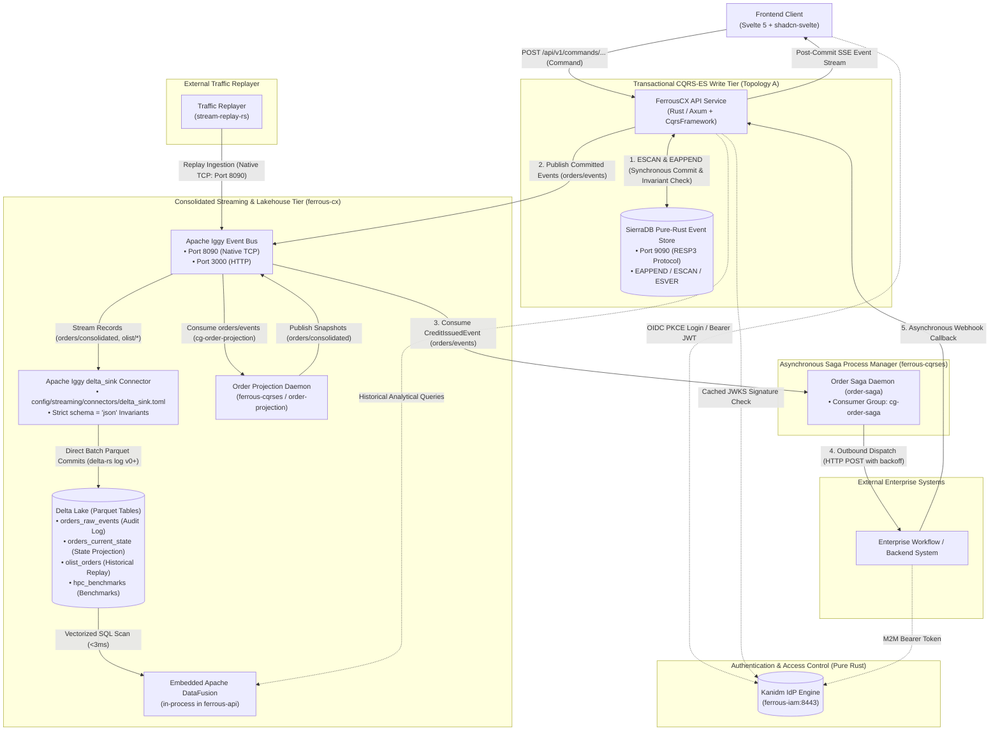

# FerrousCX

### Enterprise Conversational AI & Customer Experience Platform

[](https://github.com/reidlai/ferrous-cx)
[](https://github.com/reidlai/ferrous-cx)
[](#2-component-repositories-eight-autonomous-submodules)
[](https://docs.docker.com/compose/)
[](https://opentelemetry.io/)
[](LICENSE)

**FerrousCX** is an enterprise-grade, event-driven conversational AI and customer experience platform built on a high-performance **Rust-native stack**, integrating modern web copilot interfaces with an ultra-low-latency lakehouse architecture.

---

## 🚀 Release 1 MVP: Svelte Copilot & Rust Agentic Core

**Release 1** focuses on delivering an end-to-end, high-performance web copilot experience grounded on real-world e-commerce data:

1. **Frontend:** **Svelte 5** + **shadcn-svelte** in a 3-column layout featuring a **Transparent Agentic Workbench** and **Human-in-the-Loop (HITL)** approval workflows.
2. **Reactive Bridge:** **RxJS** unidirectional data stream bridging SSE events to Svelte 5 Runes.
3. **UI Architecture:** Strict **Atomic Design** hierarchy ensuring clean separation of presentation and business logic.
4. **Backend API Service Layer:** **Rust / Axum** API Service driven by **Goa Design v3** contracts and `rust-axum` OpenAPI code generation, leveraging native **Axum SSE** for real-time browser synchronization and embedding in-process **Apache DataFusion** (<3ms SQL).
5. **In-Memory Analytical Querying:** **Apache DataFusion** scanning **Delta Lake** Parquet tables in-process (<3ms query latency).
6. **Traffic Simulation:** **`stream-replay-rs`** (Git submodule at project root), replaying historical Parquet/CSV datasets into **Apache Iggy** via Native TCP (port 8090) with real-time timestamp shifting.
7. **Flagship Scenario:** Brazilian E-Commerce dataset (**Olist**) for order tracking, shipment delay resolution, review analysis, and courtesy credits.

---

## 🏛️ System Architecture Topology

The end-to-end dataflow across FerrousCX unites historical lakehouse analytics, high-throughput event replay, sub-millisecond CQRS-ES transaction processing, pure-Rust identity management, and asynchronous enterprise saga orchestration:



---

## 🎨 Frontend Architecture (Svelte 5 + Atomic Design)

The frontend adopts a responsive 3-column layout designed specifically for enterprise agentic workflows:

```text
┌──────────────┬──────────────────────────────────────────┬─────────────────────────────┐
│  Left Menu   │          Middle Content Panel            │       Right AI Sidecar      │
│  (Sidebar)   │           (Operational Canvas)           │   (Transparent Workbench)   │
├──────────────┼──────────────────────────────────────────┼─────────────────────────────┤
│ • Dashboard  │  Order #7a12b - Delayed in Transit       │  ▶ Thought Process (1.4s)   │
│ • Orders     │  ┌────────────────────────────────────┐  │                             │
│ • Customers  │  │ Status: [ In Transit - Alert ]     │  │  ⚡ Tool: query_lakehouse   │
│ • Settings   │  │ Est. Delivery: Oct 28 (2 days late)│  │     Latency: 2.4ms (DataFusion)
│   (API Keys) │  └────────────────────────────────────┘  │                             │
│              │  Items & Timeline:                       │  "The carrier reported a    │
│              │  • Wireless Earbuds ($49.99)             │   delay. Courtesy credit?"  │
│              │  Customer Sentiment: 😠 Frustrated       │                             │
│              │                                          │  ┌───────────────────────┐  │
│              │  [Contact Carrier]                       │  │ [Approve $15 Credit]  │  │
│              │                                          │  └───────────────────────┘  │
└──────────────┴──────────────────────────────────────────┴─────────────────────────────┘
```

### 1. RxJS Unidirectional Reactive Bridge
To guarantee predictable state management and handle high-throughput streaming events, an **RxJS observable pipeline** acts as the bridge between Axum's SSE stream and SvelteKit Runes:

$$\text{Axum SSE Stream} \xrightarrow{\text{EventSource / Fetch}} \textbf{RxJS Observable Pipeline} \xrightarrow{\text{Operators (map/filter/buffer)}} \textbf{Svelte 5 Runes } (\$state)$$

* **Unidirectional Flow:** SSE events enter RxJS observables, pass through pipeline operators (buffering tokens, handling backpressure, and routing tool-execution payloads), and update Svelte 5 `$state` runes.
* **Component Reactivity:** UI components purely read from `$state` and `$derived` runes; they never mutate streaming state directly.

### 2. Atomic Design Hierarchy
* **Atoms (Pre-built shadcn-svelte):** Primitive building blocks (`Button`, `Card`, `Badge`, `Accordion`, `Input`, `Separator`, `ScrollArea`).
* **Molecules (Pure Visual Presentation):** Stateless composite components maintaining zero business logic:
  * `ChatMessageBubble`: Displays message text and formatting.
  * `LatencyPill`: Formats query execution time (`2.4ms`) and engine badges.
  * `ToolCallHeader`: Renders tool name, status spinner, and arguments summary.
  * `ApprovalCardFrame`: Visual frame and action buttons for HITL prompts.
* **Organisms (Business Logic & State):** Domain-aware components connected to RxJS streams and Svelte runes:
  * `CopilotSidecarWorkbench`: Orchestrates message dispatch, thought accordions, and active tool calls.
  * `OrderResolutionCanvas`: Subscribes to order selection state, rendering live Olist items, timelines, and customer metrics.
  * `HitlApprovalWidget`: Handles approval/rejection button clicks and dispatches state-change mutations to the API gateway (`ferrous-api`).
  * `ProviderSettingsModal`: Manages user-supplied API keys (OpenAI, Anthropic, Google AI Studio, OpenRouter) stored locally in the browser.

---

## ⚡ High-Performance Rust Stack

* **API Service (`ferrous-api`):** **Rust / Axum** driven by **Goa Design v3** declarative contracts, compiling OpenAPI v3 specs into strongly typed Rust server traits via `rust-axum` and synchronizing live browser state via native **Axum SSE** (`axum::response::sse::Sse`).
* **LLM Orchestration:** **`rig` (`rig-core`)** for pure-Rust agent pipelines, prompt construction, native tool execution, and direct Hugging Face integration via `rig::providers::huggingface` (`huggingface::QWEN2_5`).
* **Analytical Query Engine:** **Apache DataFusion** executing vectorized SQL scans in <3ms directly against Delta Lake Parquet tables, embedded in-process in `ferrous-api` and `ferrous-cqrses` for sub-millisecond historical analytics.
* **Transactional Event Store:** **SierraDB** (`sierradb`), pure-Rust RESP3 distributed event store providing sub-millisecond atomic append operations (`EAPPEND`), event stream scanning (`ESCAN`), and version checks (`ESVER`) with optimistic concurrency control for `ferrous-cqrses` aggregates.
* **Message Broker & Lakehouse Sinks:** **Apache Iggy** for ultra-high throughput event and conversation telemetry streaming with built-in native **`delta_sink`** connector streaming directly to Delta Lake Parquet tables in `/data/delta/` (`orders_raw_events`, `orders_current_state`, `olist_orders`, `hpc_benchmarks`) with strict `schema = "json"` invariants.
* **CQRS-ES Engine (`ferrous-cqrses`):** Pure-Rust Domain-Driven CQRS/ES engine built on the `cqrs-es` crate. Under Topology A, `ferrous-api` hosts the synchronous `CommandHandler` backed by SierraDB (`EventStore`) enforcing invariants ($20 courtesy credit cap, lifecycle states) before committing atomic event streams (`EAPPEND`), and dispatches committed domain events to Apache Iggy (`orders/events`). The dedicated `order-projection` daemon consumes `orders/events` via consumer group `cg-order-projection`, constructs `ConsolidatedOrderProjection` snapshots, and emits them to `orders/consolidated` for Apache Iggy `delta_sink` Delta Lake table materialization.
* **Asynchronous Saga Process Manager (`order-saga`):** Dedicated standalone daemon in `ferrous-cqrses` (`order-saga`) consuming domain events from Apache Iggy via consumer group `cg-order-saga`. Decouples long-running enterprise workflows from synchronous command handling and read projections. Dispatches outbound settlement requests with correlation tokens, exponential backoff, and retry limits, while `ferrous-api` hosts the M2M authenticated Webhook Ingress Gateway to process asynchronous callbacks and transition aggregate state.

### Enterprise Workflow & Asynchronous Saga Orchestration (Epic 18)

To preserve the **CQRS/ES Replay Invariant**, read-side projections must remain strictly pure: replaying events during disaster recovery or read-model re-indexing must never trigger external side-effects (e.g., duplicate workflow actions or side-effect calls).

FerrousCX solves this through an asynchronous, event-driven Process Manager pattern:

$$\begin{aligned}
\text{Domain Event } (\texttt{CreditIssuedEvent}) &\xrightarrow{\text{Apache Iggy } (\texttt{orders/events})} \textbf{OrderSagaManager } (\texttt{cg-order-saga}) \\
&\xrightarrow[\text{Exponential Backoff}]{\text{Outbound HTTP POST}} \textbf{Enterprise Workflow / Backend System} \\
&\xrightarrow[\text{Kanidm M2M Bearer Token}]{\text{Async Webhook Callback}} \textbf{Ferrous API Gateway } (\texttt{/api/v1/webhooks/orders/settlement-callback}) \\
&\xrightarrow{\text{Command Dispatch}} \textbf{SierraDB Event Store } (\texttt{EAPPEND } \rightarrow \texttt{CourtesyCreditSettled})
\end{aligned}$$

1. **Decoupled Consumer Groups:** `order-projection` operates under consumer group `cg-order-projection`, while `order-saga` operates under `cg-order-saga`. Projection lag or replays never disrupt or duplicate outbound saga dispatches.
2. **Outbound Dispatcher with Backoff:** The saga daemon implements the `EnterpriseDispatcher` trait with configurable retries (`MAX_RETRIES`), exponential backoff (`BACKOFF_INITIAL_MS`, `BACKOFF_MAX_MS`), non-transient error classification (e.g. HTTP 4xx errors are acknowledged without infinite retrying), and capped response memory bounds (64KB).
3. **M2M Authenticated Ingress Gateway:** External callbacks post to `POST /api/v1/webhooks/orders/settlement-callback` in `ferrous-api`. Requests require Kanidm M2M Bearer tokens (`svc_ferrous_api`), validate payload schemas, and dispatch domain commands (`SettleCourtesyCreditCommand` or `FailCourtesyCreditSettlementCommand`) to atomically update the order aggregate in SierraDB.

### Direct `rig` + `DataFusion` Integration
Tools implement `rig::tool::Tool` and directly hold an `Arc<SessionContext>`:
```rust
pub struct LakehouseOrderQueryTool {
    pub df_ctx: Arc<SessionContext>,
}

impl Tool for LakehouseOrderQueryTool {
    const NAME: &'static str = "query_order_lakehouse";
    type Error = ToolError;
    type Args = OrderQueryArgs;
    type Output = OrderSummary;

    async fn call(&self, args: Self::Args) -> Result<Self::Output, Self::Error> {
        let sql = format!("SELECT * FROM orders WHERE order_id = '{}'", args.order_id);
        let df = self.df_ctx.sql(&sql).await?;
        let batches = df.collect().await?;
        // Scanned in-memory in ~2ms with zero IPC overhead
        Ok(parse_order_summary(batches)?)
    }
}
```

---

## 🔄 Real-Time Traffic Simulation (`stream-replay-rs`)

`stream-replay-rs` ([reidlai/stream-replay-rs](https://github.com/reidlai/stream-replay-rs)) is the **generic, independent** replayer used by this repository to turn the Olist dataset into live traffic. It knows nothing about FerrousCX: the dataset, the replay profiles and the topics (`olist/orders_stream`) belong to `ferrous-cx`. It is never controlled from the UI, the API or the agent.

### Key Capabilities
* **Dual Format:** Usable as a standalone CLI tool (`cargo install`) and as an embeddable library crate dependency in other Rust services.
* **Dataset Agnostic:** Ingests CSV, Parquet or JSONL files (`--input-file-format parquet --input-file-path <path>`) across arbitrary domains.
* **Pluggable Multi-Sink Architecture:** Dispatches events to a Kafka-protocol endpoint such as the Apache Iggy gateway (`--sink kafka`), NATS JetStream (`--sink nats`), Fluvio (`--sink fluvio`), Eclipse iceoryx2 zero-copy IPC (`--sink iceoryx2`), or terminal inspection (`--sink stdout`).
* **Timestamp Rebasing and Speed:** Rebases historical event timestamps onto the live clock and paces them by `--speed` (default `1.0`, original spacing) or by a fixed `--rate` in events per second. The two are mutually exclusive.

---

## 📊 Flagship Scenario & Playback Calibration

### 1. Olist Brazilian E-Commerce Dataset (Flagship for Release 1)
* **Purpose:** Retail customer support, order fulfillment, shipping delay mitigation, and sentiment analysis.
* **Schema:** Relational Parquet tables including `orders`, `order_items`, `customers`, `payments`, `reviews`, and `sellers`.
* **Execution:** Queried in real-time by `rig` agents via `DataFusion`, with order events replayed live through `stream-replay-rs` into `Apache Iggy` $\rightarrow$ native `delta_sink` connector $\rightarrow$ `Delta Lake`.

### 2. Replay Profiles: Demo (10x) and Load (`--rate 25`)
`ferrous-cx` ships two replay profiles for `olist/orders_stream`. The replayer itself defaults to speed `1.0`; the profile sets the speed.

* The flagship Brazilian Olist e-commerce dataset contains **100,000 orders** spanning **730 days** (1,051,200 minutes).
* **Historical Baseline Arrival Rate**:
  $$\text{Rate}_{\text{historical}} = \frac{100,000 \text{ orders}}{1,051,200 \text{ minutes}} \approx 0.095 \text{ orders/min}$$
* **Demo profile (`--speed 10x`)**:
  $$\text{Rate}_{\text{accelerated}} = 0.095 \times 10 \approx 0.95 \text{ orders/min} \approx \mathbf{1\text{ order/minute}}$$
  At **10x**, the steady-state arrival rate is **~1 order/minute**, keeping platform intake queues actively populated during live human inspection and interactive operator workflows without overwhelming development machines.
* **Load profile (`--rate 25`)**: a fixed 25 events per second, ignoring the dataset's own spacing. It drives the SM-3 stability run (more than two hours, long enough for at least one dataset loop with `--loop-id-salt`) and the platform's HPC benchmark.

### 3. Monotonic Timestamp Advancement & Primary Key Salting
* **Monotonic Time Shifting**:
  $$\text{Timestamp}_{\text{emitted}} = \text{Timestamp}_{\text{start}} + \frac{(\text{Timestamp}_{\text{record}} - \text{Timestamp}_{\text{first}}) + \text{loop\_count} \times \Delta_{\text{dataset}}}{\text{speed}}$$
  Guarantees strictly increasing streaming event watermarks with zero late-data drops or backward clock regressions across infinite looping simulations.
* **Entity ID Salting**: Appends loop iteration markers (`_L1`, `_L2`) to entity primary keys (`order_id`) when `--loop-id-salt` is enabled, eliminating primary key deduplication collisions in downstream Delta Lake tables (`orders_raw_events`, `orders_current_state`).

### 4. MultiWOZ (Multi-Domain Wizard-of-Oz)
* **Purpose:** Multi-turn dialogue state tracking and cross-domain hotel, restaurant, and train bookings.

### 5. Google Schema-Guided Dialogue (SGD)
* **Purpose:** API-driven state transitions and strict microservice schema validation across 20+ domains.

---

## 📁 Repository Architecture & Modular Submodule Ecosystem

The **FerrousCX** public hub (`ferrous-cx`) maintains the authoritative architectural specifications, C4 diagrams, and ecosystem index.

### 1. `ferrous-cx` Hub Repository Structure

```text
ferrous-cx/ (This Repository - Core Public Repository: demo config, runtime stack, docs, component submodules)
│
├── docker/                      # Compose stack, OTel tiers, smoke tests (absorbed from the former ferrous-docker)
│
├── docs/                        # Architecture deep-dives, C4 diagrams, and specifications
│   ├── c4/                      # C4 model architecture diagrams (Context, Container, Component)
│   ├── topologies/              # System topologies, streaming pipelines & IAM flows
│   ├── datasets/                # Reference dataset specifications (Olist, MultiWOZ, SGD)
│   └── security/                # Day-0 attack defense matrix, threat models & WAF policies
│
├── scripts/                     # Ecosystem validation & documentation helper scripts
│
├── LICENSE                      # Open-source license (MIT / Apache-2.0)
└── README.md                    # Public ecosystem index, architecture overview & quickstart
```

---

### 2. Component Repositories (Eight Autonomous Submodules)

`ferrous-cx` aggregates eight single-responsibility Git repositories as submodules. Each component is decoupled, contains its own documentation, pre-commit validation, and container builds. Dependencies point strictly one way: **a component must never include `ferrous-cx`, or a repository that contains it, as a submodule or path dependency** (AD-26).

| # | Component | Repository | Architectural Role | Tech Stack |
| :-: | :--- | :--- | :--- | :--- |
| **1** | **`stream-replay-rs`** | [`reidlai/stream-replay-rs`](https://github.com/reidlai/stream-replay-rs) | Independent, dataset-agnostic multi-sink traffic replayer with timestamp rebasing and speed control | Pure-Rust CLI & Library Crate |
| **2** | **`ferrous-iam`** | [`reidlai/ferrous-iam`](https://github.com/reidlai/ferrous-iam) | Identity & Access Management container engine (Kanidm pure-Rust IdP, OIDC/OAuth2). Platform personas (`seed-rbac.json`, `seed-m2m.json`) and TLS certificates are decoupled into and managed by `ferrous-cx`. | Pure-Rust Kanidm / Docker |
| **3** | **`ferrous-vectordb`** | [`reidlai/ferrous-vectordb`](https://github.com/reidlai/ferrous-vectordb) | Qdrant vector database indexing enterprise SOPs & support transcripts | Qdrant Vector DB / FastEmbed |
| **4** | **`ferrous-cqrses`** | [`reidlai/ferrous-cqrses`](https://github.com/reidlai/ferrous-cqrses) | Domain-Driven CQRS/ES Library (`cqrs-es`), Order Projection Daemon (`order-projection`), and Asynchronous Saga Process Manager Daemon (`order-saga`) with SierraDB EventStore | Pure-Rust Library Crate & Daemons |
| **5** | **`ferrous-api`** | [`reidlai/ferrous-api`](https://github.com/reidlai/ferrous-api) | Contract-First Axum API Service (Goa DSL, rust-axum, in-process DataFusion <3ms SQL, Axum SSE, M2M Settlement Webhook Gateway) | Goa v3 / Axum / DataFusion |
| **6** | **`ferrous-agent`** | [`reidlai/ferrous-agent`](https://github.com/reidlai/ferrous-agent) | Pure-Rust Multi-Provider AI Engine (`rig-core`), Context Sanitizer & In-Process Benchmarks | `rig-core` / Context Sanitizer |
| **7** | **`ferrous-frontend`** | [`reidlai/ferrous-frontend`](https://github.com/reidlai/ferrous-frontend) | Svelte 5 + shadcn-svelte 3-column UI workbench, including the read-only Replay Monitor | Svelte 5 / shadcn-svelte / RxJS / Tailwind |
| **8** | **`ferrous-reverseproxy`** | [`reidlai/ferrous-reverseproxy`](https://github.com/reidlai/ferrous-reverseproxy) | Zentinel (Cloudflare Pingora) Edge Reverse Proxy, TLS 1.3 Termination & OWASP WAF | Pure-Rust Zentinel / Pingora / CRS |

> [!NOTE]
> Following the streaming consolidation in Epic 16 and SierraDB deployment in Epic 17, `ferrous-streaming` and `iggy-kafka-bridge` were retired: Apache Iggy with native `delta_sink` connector, SierraDB (`sierradb`), and the `streaming-admin` administrative suite are orchestrated directly within `ferrous-cx`.

---

## 🐳 Runtime Orchestration & OpenTelemetry

`ferrous-cx` provides the unified integration, Day-0 security hardening, and developer runtime harness for the platform:

1. **Zero-Daemon Local Development:** Launch the platform with a single `docker compose up -d`, requiring zero external host dependencies.
2. **Explicit Healthcheck Dependency Graph:** Startup is gated with `condition: service_healthy`. `iggy-broker`, `sierradb`, and `ferrous-vectordb` boot first, then storage consumers, `order-projection` (`ferrous-cqrses`), the API gateway (`ferrous-api`, gated by `sierradb` and `iggy-broker`), `order-saga` (`ferrous-cqrses`, gated by `iggy-broker`, `sierradb`, and `ferrous-api`), reverse proxy and frontend. `ferrous-iam` gates only `ferrous-api`, `ferrous-agent` and `ferrous-frontend`; the data platform does not depend on it.
3. **Day-0 Kernel Hardening:** All application containers enforce:
   - `read_only: true` (immutable root filesystem).
   - `cap_drop: ALL` (zero elevated Linux capabilities).
   - `security_opt: [no-new-privileges:true]`.
   - `tmpfs: /tmp:noexec,nosuid,nodev,size=64M`.
4. **3-Tier OpenTelemetry Developer Runtime:**
   - **Tier 1 (Disabled):** `OTEL_SDK_DISABLED=true` (zero span overhead, clean stdout).
   - **Tier 2 (Console):** `OTEL_TRACES_EXPORTER=console` (human-readable trace logs in the terminal).
   - **Tier 3 (OTLP Egress):** Ephemeral in-memory Jaeger All-In-One (`jaegertracing/jaeger:2.3.0`) on ports 4317 (gRPC) and 4318 (HTTP), with the Web UI on port 16686.
5. **Pre-Commit DevSecOps Automation:** Hooks verify secret leakage (`gitleaks`), compose syntax, topology security, OpenTelemetry wiring, and quickstart documentation.
6. **Platform Smoke Validation:** Scripted end-to-end checks (`smoke-test.sh` / `smoke-test.ps1`) verify all 8 HTTP/HTTPS endpoints across the stack.

### Runtime Topology

| Component | Container Service | Primary Ports | Healthcheck Probe | Day-0 Hardened |
| :--- | :--- | :---: | :--- | :---: |
| `ferrous-iam` | `kanidmd` | `8443` (HTTPS), `3636` (LDAPS) | `/sbin/kanidmd version` | Read-only |
| `ferrous-cx` | `ferrous-iggy-broker` | `3000` (HTTP), `8090` (TCP) | Iggy ping HTTP 200 | Yes |
| `ferrous-cx` | `ferrous-sierradb` | `9090` (RESP3) | TCP port 9090 probe | Yes |
| `ferrous-vectordb` | `ferrous-vectordb` | `6333` (HTTP), `6334` (gRPC) | `GET /readyz` HTTP 200 | Yes |
| `ferrous-cqrses` | `order-projection` | Internal | `/order_projection --healthcheck` | Yes |
| `ferrous-cqrses` | `order-saga` | Internal | `/order_saga --healthcheck` | Yes |
| `ferrous-api` | `ferrous-api` | `8080` (HTTP) | `GET /health` HTTP 200 | Yes |
| `ferrous-agent` | `ferrous-agent` | `8081` (HTTP) | `GET /health` HTTP 200 | Yes |
| `ferrous-frontend` | `ferrous-frontend` | `5173` (HTTP) | `GET /health` HTTP 200 | Yes |
| `ferrous-reverseproxy` | `ferrous-reverseproxy`| `80` (HTTP), `443` (HTTPS) | TCP port 80 check | Yes |
| `ferrous-cx` | `jaeger` (ephemeral) | `16686` (UI), `4317` (gRPC), `4318` (HTTP) | `GET /` HTTP 200 | Yes |

---

## 🛠️ Developer Quickstart

### Prerequisites
* **Docker & Docker Compose:** v2.29+
* **PowerShell 7+** (Windows) or **Bash** (macOS/Linux)
* **Rust 1.80+** (required for `setup-topics`, `setup-iam`, and `stream-replay-rs`)

### 1. Clone the Public Repository
```bash
git clone --recurse-submodules https://github.com/reidlai/ferrous-cx.git
cd ferrous-cx
```

### 2. Configure Environment & Generate Dev TLS Certificates
```bash
cp .env.example .env
cp docker/.env.example docker/.env

# Generate self-signed Dev TLS certificates for Kanidm (pure Rust rcgen)
cargo run --bin setup-iam -- --generate-certs
```

### 3. Launch the Unified Runtime Stack
```bash
docker compose up -d
docker compose ps
```

### 4. Provision Apache Iggy Topics, Delta Lake Storage, & IAM Personas
The automated Cargo provisioners idempotently initialize all streams, topics, consumer groups, Delta Lake tables, and IAM personas:
```bash
# Cross-Platform Unified Administration Suite (Cargo)
cargo run --bin streaming-admin -- all --dry-run   # Full conformance audit across Steps 2 through 6
cargo run --bin streaming-admin -- all             # Live provisioning, Delta Lake storage init, & connector validation

cargo run --bin setup-iam -- --dry-run             # IAM persona & M2M audit
cargo run --bin setup-iam                         # Idempotent IAM setup

# Optional shell wrappers:
# Linux/macOS:        ./scripts/setup-topics.sh && ./scripts/setup-iam.sh
# Windows PowerShell: .\scripts\setup-topics.ps1; .\scripts\setup-iam.ps1
```

### 5. Replay Olist Traffic
Produce real-world e-commerce traffic through native Apache Iggy stream ingestion (`127.0.0.1:8090`):
```bash
# Option A: Run directly via Cargo
# From a recursive standalone clone:
cargo run --release --manifest-path ./stream-replay-rs/Cargo.toml -- --config profiles/olist-demo.toml
# Or from a sibling monorepo workspace:
cargo run --release --manifest-path ../stream-replay-rs/Cargo.toml -- --config profiles/olist-demo.toml

# Option B: Run installed binary
stream-replay-rs --config profiles/olist-demo.toml
```

### 6. Inspect Services & Observability
- **Perimeter Reverse Proxy:** `https://localhost:443/` (or `http://localhost:80/`)
- **Direct Frontend UI:** `http://localhost:5173/` (Operator Studio, strictly read-only)
- **Distributed Traces (Jaeger):** `http://localhost:16686/`
- **End-to-End Smoke Test:**
  ```bash
  powershell -ExecutionPolicy Bypass -File scripts/smoke-test.ps1
  # or: bash scripts/smoke-test.sh
  ```
- **Vulnerability Audit:**
  ```bash
  powershell -ExecutionPolicy Bypass -File scripts/scan-vulnerabilities.ps1
  # or: bash scripts/scan-vulnerabilities.sh
  ```

---

## 🔒 The One-Way Dependency Rule (AD-26)

`ferrous-cx` acts as the root orchestrator and aggregator. To prevent circular dependencies:
1. **No component submodule may reference `ferrous-cx`** in `.gitmodules`, configuration files, or source code.
2. Component submodules are independently buildable, testable, and releasable.
3. The automated audit script enforces this rule across all 10 component repositories:
   ```bash
   powershell -ExecutionPolicy Bypass -File scripts/check-submodules.ps1
   # or: bash scripts/check-submodules.sh
   ```
For contributors working on the BMAD planning artifacts and the components together:
```bash
git clone --recurse-submodules https://github.com/reidlai/ferrouscx-bmad.git
cd ferrouscx-bmad
git submodule update --init --recursive
```

---

## 🚀 Local Demo Stack: Provision Services & Run `stream-replay-rs`

This walk-through is carried over from the former `ferrous-docker` README and adapted to the consolidated platform. It describes how to bring the stack up and drive it with the `stream-replay-rs` CLI for a local demo or manual testing. Paths assume the compose stack lives under `docker/` in this repository; run every command from the `ferrous-cx` checkout root.

### Prerequisites

| Tool | Version | Used for |
| :--- | :--- | :--- |
| Docker + Compose | `v2.29+` | Building images and running the stack |
| Rust | `1.80+` | Building `streaming-admin`, `setup-iam`, and installing `stream-replay-rs` |

Make sure the submodules are checked out (`git submodule update --init --recursive`).

> [!IMPORTANT]
> **Shells.** On macOS / Linux use the `bash` blocks as written. On Windows use **Git Bash** for the `bash` blocks, or **PowerShell** for the `powershell` blocks. `cmd.exe` can only run `.bat` launchers, not the Bash or PowerShell blocks.

### 1. Build the Local Images

The compose file references images that can be built locally or pulled from registries:

```bash
docker build -t ferrous-iam:latest ferrous-iam
docker build -t ferrous-streaming-iggy:latest -f docker/Dockerfile.iggy .
```

### 2. Generate Dev TLS Certificates

Kanidm requires valid TLS certificates to boot. Generate self-signed development certificates with required SANs (`localhost`, `ferrous-iam`, `ferrouscx.local`, `127.0.0.1`, `::1`) in pure Rust using `rcgen` (zero host `openssl` CLI or Python dependencies):

```bash
# Cross-Platform (Cargo)
cargo run --bin setup-iam -- --generate-certs

# Force overwrite existing certificates if needed:
cargo run --bin setup-iam -- --generate-certs --force

# Optional shell wrappers:
# Linux/macOS:        ./scripts/setup-iam.sh --generate-certs
# Windows PowerShell: .\scripts\setup-iam.ps1 -GenerateCerts
```

Certificates are generated directly into `config/iam/certs/` (`chain.pem` and `key.pem`), where Docker Compose automatically mounts them into the Kanidm container.

### 3. Create `.env`

Iggy signs its admin JWTs with a shared secret that defaults to **empty** when unset, and the provisioning scripts in step 5 must use the same secret as the broker. Generate a random secret and set `IGGY_HTTP_JWT_ENCODING_SECRET` and `IGGY_HTTP_JWT_DECODING_SECRET` to the same value (HS256 requires identical secrets). `.env` holds secrets, so keep it out of Git. The data platform authenticates with Iggy's native credentials, not Kanidm.

### 4. Start the Stack

```bash
docker compose up -d
docker compose ps        # wait until ferrous-iam, iggy-broker, sierradb, and vectordb report "healthy"
```

| Service | Endpoint | Protocol / Role |
| :--- | :--- | :--- |
| Kanidm (IAM) | `https://localhost:8443` (self-signed cert), LDAPS `3636` | Pure-Rust Identity Provider |
| Apache Iggy HTTP | `http://localhost:3000/ping` | Broker HTTP Management & Health |
| Apache Iggy native TCP | `localhost:8090` | High-Throughput Streaming & WAL |
| SierraDB Event Store | `localhost:9090` | Pure-Rust RESP3 Event Store (`EAPPEND`, `ESCAN`, `ESVER`) |
| Qdrant Vector DB | `http://localhost:6333/readyz` | Vector DB for SOPs & Transcripts |
| Ferrous API Gateway | `http://localhost:8080/health` | Axum API + SSE + In-Process DataFusion |
| Settlement Webhook Gateway | `http://localhost:8080/api/v1/webhooks/orders/settlement-callback` | M2M Async Settlement Ingress (Kanidm JWT) |
| Order Saga Daemon | Internal (`cg-order-saga`) | Outbound Enterprise Saga Process Manager |
| Frontend UI | `http://localhost:5173/` | Svelte 5 Operator Studio (read-only) |

### 5. Provision Topics, Consumer Groups, Delta Lake Storage, & IAM Personas

`ferrous-cx` owns the platform streaming administration and IAM persona configurations. Use the native cross-platform Cargo tools to audit and idempotently provision the entire platform:

```bash
# Cross-Platform (Cargo)
cargo run --bin streaming-admin -- all --dry-run   # Conformance audit across topics, groups, delta storage, & delta_sink
cargo run --bin streaming-admin -- all             # Live stream, topic, consumer group, and Delta Lake initialization

cargo run --bin setup-iam -- --dry-run             # IAM persona & M2M audit
cargo run --bin setup-iam                         # Idempotent IAM setup

# Optional shell wrappers:
# Linux/macOS:        ./scripts/setup-topics.sh && ./scripts/setup-iam.sh
# Windows PowerShell: .\scripts\setup-topics.ps1; .\scripts\setup-iam.ps1
```

Both tools support `--dry-run` for non-destructive pre-flight auditing. They connect directly to running container ports (`http://localhost:3000` for Iggy, `https://localhost:8443` for Kanidm) and are fully idempotent.

### 6. Run `stream-replay-rs`

```bash
cargo install stream-replay-rs   # or: cargo install --git https://github.com/reidlai/stream-replay-rs

# Smoke test with no broker involved
stream-replay-rs --input-file-path data/olist_orders.parquet --sink stdout --speed 10x --progress

# Point at Apache Iggy stream ingestion from the stack (demo profile: 10x)
stream-replay-rs --config profiles/olist-demo.toml
```

Looping, fixed-rate and timestamp options are in the [`stream-replay-rs` README](https://github.com/reidlai/stream-replay-rs). For the load profile, replace `--speed 10x` with `--rate 25 --loop --advance-loop-timestamps --loop-id-salt`.

### 7. Check the Stack

```bash
curl http://localhost:3000/ping            # Iggy: "pong"  (PowerShell: use curl.exe)
curl http://localhost:8080/health         # API Service health
```

### 8. Stop and Reset

```bash
docker compose down            # stop, keep data
docker compose down -v         # also delete the named volumes
# Persistent state lives in named volumes iggy_data, sierradb_data, and delta_data
```
